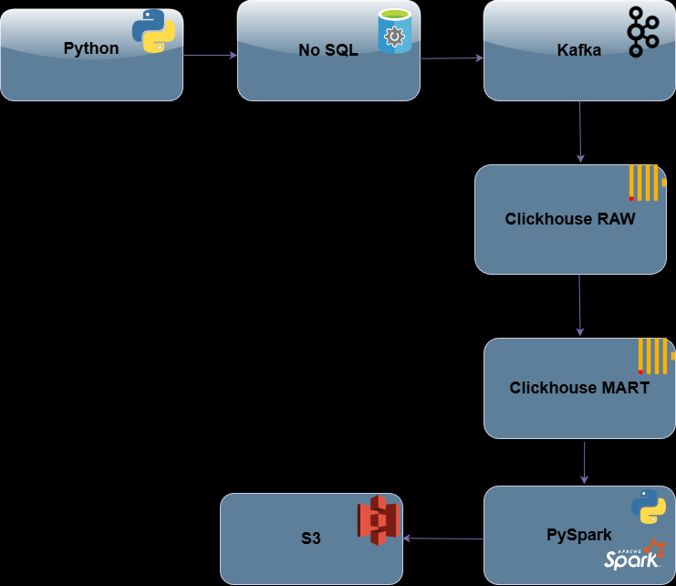
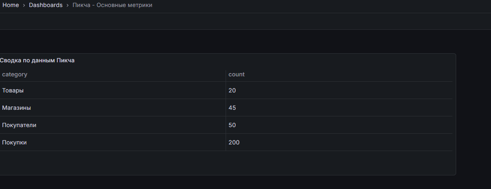
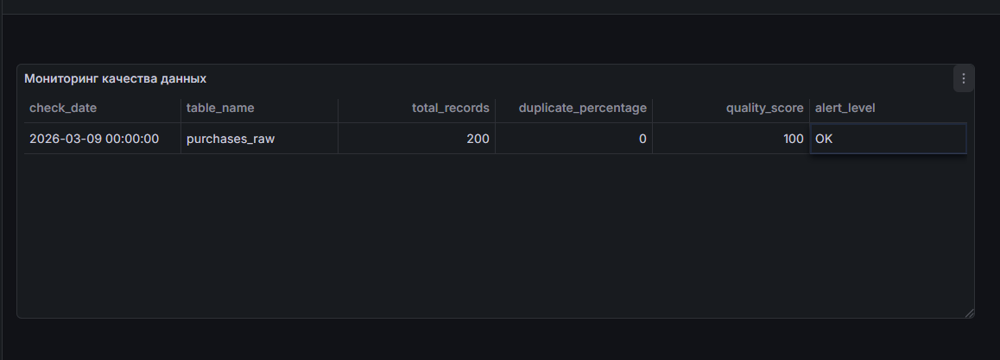
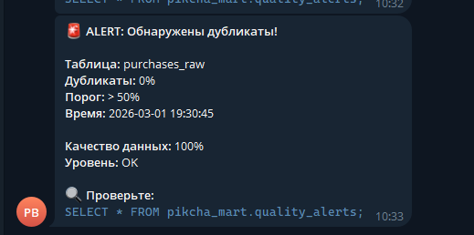
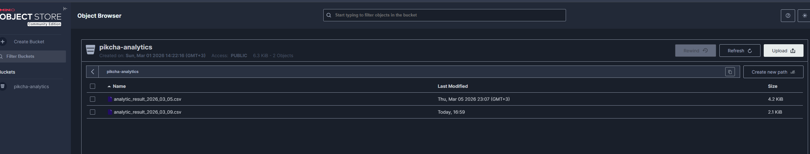
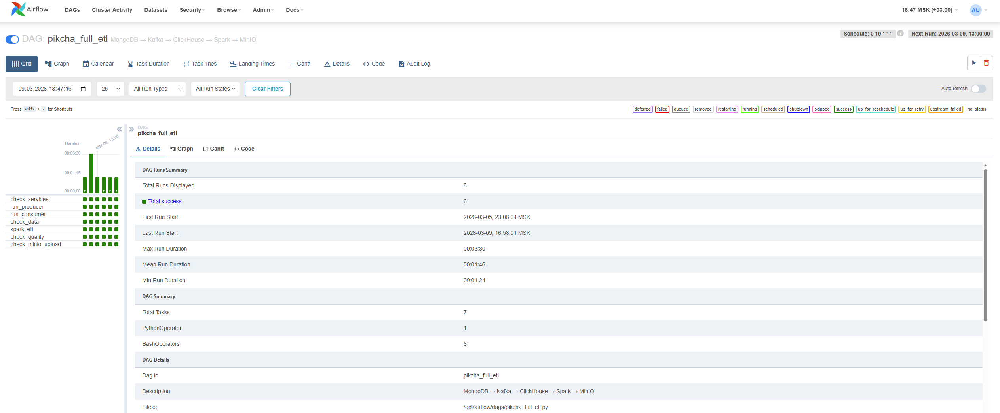

# 🛒 Аналитическая платформа для сети магазинов "Пикча"

  
  
  
  
  
  
  
  
  
  
  
  **End-to-End Data Engineering решение для ритейл-аналитики**

---

## 📋 О проекте

Аналитическая платформа для сети продуктовых магазинов "Пикча". Система собирает данные из NoSQL хранилища, обрабатывает через Kafka, очищает в ClickHouse и строит поведенческие признаки покупателей с помощью PySpark.

**Результат:**  бизнес-метрики и готовые датасеты для аналитики в MinIO (S3-совместимое хранилище).

---

## 🏗️ Архитектура

  
   
  <em>Архитектура решения: от генерации данных до витрины признаков</em>

---
## 🐳 Технологический стек

| Компонент | Технология | Назначение |
|-----------|------------|------------|
| **Контейнеризация** | Docker + Docker Compose | Оркестрация всех сервисов |
| **База данных источника** | MongoDB | NoSQL хранилище (имитация контура заказчика) |
| **Брокер сообщений** | Apache Kafka | Стриминг данных между системами |
| **Хранилище RAW-слоя** | ClickHouse | Аналитическая СУБД для хранения сырых данных |
| **Хранилище MART-слоя** | ClickHouse | Очищенные и нормализованные данные |
| **Обработка данных** | PySpark | Расчёт поведенческих признаков |
| **Оркестрация** | Apache Airflow | Планирование и мониторинг ETL-процессов |
| **Визуализация** | Grafana | Дашборды и мониторинг |
| **Объектное хранилище** | MinIO | S3-совместимое хранилище для результатов |
| **Мониторинг** | Telegram Bot | Алерты о качестве данных |

## 🔧 Этапы реализации

### Этап 1️⃣: Генерация данных и имитация контура заказчика

**Задача:** создать тестовые данные, максимально приближенные к реальным, и загрузить их в NoSQL-хранилище, имитирующее контур заказчика.

**Что сделано:**
- ✨ Написаны скрипты, которые создают:
  - **45 магазинов** двух форматов ("Большая Пикча" и "Маленькая Пикча")
  - **20 товаров** с полной структурой (КБЖУ, производитель, страна)
  - **45 покупателей** (минимум по одному на магазин)
  - **200+ покупок** с разными сценариями

- 📦 Все JSON-файлы загружены в **MongoDB** через [load_data.py](load_data_mongodb/load_data_mongo.py)

### Этап 2️⃣: Стриминг данных через Kafka в RAW-слой

**Задача:** забрать данные из MongoDB и доставить их в ClickHouse, обезличив персональную информацию.

**Реализация:**

📤 **Producer** ([producer.py](mongodb_kafka_clickhouse/producer.py)):
- Читает данные из MongoDB
- **Шифрует email и телефон** (поля `email` и `phone`)
- Приводит данные к единому формату
- Отправляет в топики Kafka: `stores`, `products`, `customers`, `purchases`
- Добавляет `event_time` — метку времени загрузки

📥 **Consumer** ([consumer.py](mongodb_kafka_clickhouse/consumer.py)):
- Забирает сообщения из Kafka
- Создаёт таблицы в **ClickHouse (RAW-слой)**
- Сохраняет оригинальную JSON-структуру в поле `json_data` 
- Все вложенные объекты раскладывает по колонкам (с типом String)

### Этап 3️⃣: Очистка данных (RAW → MART)
#### SQL-скрипты

📄 create_mart_tables.sql — создание таблиц в MART с движком ReplacingMergeTree

📄 create_materialized_views.sql — MV для трансформации данных

📄 create_monitoring.sql — таблицы для мониторинга качества

**Логика очистки:**
- 🔄 **Трансформация** — Materialized View (lower, trim, валидация дат)
- 🗑️ **Дедупликация** — ReplacingMergeTree в целевых таблицах
- ✅ **Пустые строки → NULL** — проверка в MV
- 📅 **Валидация дат** — проверка, что дата не позже текущей

### Этап 4️⃣: Мониторинг и алертинг в Grafana
#### Задача: визуализировать ключевые метрики и оперативно узнавать о проблемах с качеством данных.

Что сделано:
#### 📈 Дашборд 1: «Сводка по данным Пикча»
**Отображаемые метрики:**
- 🏪 **Магазины:** 45 (соответствует требованию)
- 📦 **Товары:** 20 (ассортимент)
- 👥 **Покупатели:** 50 (активная аудитория)
- 🛒 **Покупки:** 200 (объём продаж)

#### 📈 Основные метрики

#### 📉 Дашборд 2: «Мониторинг качества данных»
### Мониторинг качества данных

**Ключевые показатели:**
- ✅ **200 записей** в purchases_raw
- ✅ **0% дубликатов** — данные чисты
- ✅ **100% качество** — все записи валидны
- ✅ **Статус OK** — система работает штатно
- 
#### 🤖 Telegram-алертинг

**Как работает:**
- 🔍 Проверка каждые 5 минут
- ⚠️ Порог срабатывания: >50% дубликатов
- 📱 Мгновенная отправка в Telegram

Уведомление мгновенно приходит в Telegram-бот

*Алерт о качестве данных в Telegram*

### Этап 5️⃣: PySpark ETL — построение поведенческих признаков покупателей

**Задача:** на основе очищенных данных в MART-слое рассчитать матрицу признаков, которая позволит сегментировать покупателей и выявлять их поведенческие паттерны для дальнейшего анализа и кластеризации.

#### 📥 Источник данных

Скрипт [spark/customer_features.py](spark/customer_features.py) читает данные напрямую из ClickHouse MART:

#### 🧠 Рассчитываемые признаки
## 📊 Аналитическая витрина (30 признаков)

ETL строит **30 бинарных признаков** для каждого покупателя на основе истории покупок.

### 🏷️ Категорийные признаки (7)

Характеризуют покупательское поведение по товарным категориям:

| Признак | Описание | Период |
|---------|----------|--------|
| `bought_milk_last_30d` | Покупал молочные продукты | 30 дней |
| `bought_fruits_last_14d` | Покупал фрукты и ягоды | 14 дней |
| `bought_veggies_14d` | Покупал овощи и зелень | 14 дней |
| `not_bought_veggies_14d` | НЕ покупал овощи | 14 дней |
| `bought_meat_last_week` | Покупал мясо/рыбу | 7 дней |
| `buys_bakery` | Покупал хлеб и выпечку | всё время |
| `fruit_lover` | 3+ покупок фруктов | 30 дней |

### 🛒 Поведенческие признаки (15)

Описывают паттерны покупок:

| Признак | Описание |
|---------|----------|
| `recurrent_buyer` | Более 2 покупок за последние 30 дней |
| `inactive_14_30` | Не покупал от 14 до 30 дней |
| `new_customer` | Зарегистрирован менее 30 дней назад |
| `bulk_buyer` | Средний чек > 1000 |
| `low_cost_buyer` | Средний чек < 200 |
| `single_item_buyer` | ≥50% покупок из одного товара |
| `family_shopper` | В среднем ≥4 товара в чеке |
| `weekend_shopper` | ≥60% покупок по выходным |
| `night_shopper` | Покупал после 20:00 |
| `morning_shopper` | Покупал до 10:00 |
| `early_bird` | Покупал в обед (12-15) |
| `no_purchases` | Нет ни одной покупки |
| `varied_shopper` | Покупал товары из ≥4 разных категорий |
| `delivery_user` | Пользовался доставкой |
| `organic_preference` | Покупал органические продукты |

### 🏪 Признаки лояльности и предпочтений (8)

Характеризуют отношение к магазинам и способы оплаты:

| Признак | Описание |
|---------|----------|
| `store_loyal` | Покупает только в одном магазине |
| `switching_store` | Покупает в разных магазинах |
| `loyal_customer` | Участник программы лояльности и ≥3 покупок |
| `multicity_buyer` | Покупает в нескольких городах |
| `prefers_cash` | ≥70% покупок наличными |
| `prefers_card` | ≥70% покупок картой |
| `recent_high_spender` | Потратил >2000 за последние 7 дней |
| `vegetarian_profile` | Не покупал мясо 90 дней |

### 📋 Формат данных

| Поле | Тип | Описание |
|------|-----|----------|
| `customer_id` | `string` | Уникальный идентификатор покупателя |
| `признак` | `integer` | `1` — признак выражен, `0` — не выражен |

> Все признаки бинарные: `1` означает наличие признака, `0` — отсутствие.

#### 📈 Возможные бизнес-выводы

На основе витрины можно анализировать:

| Направление | Признаки | Что даёт |
|-------------|----------|----------|
| Канал доставки | `delivery_user` | Доля и частота использования доставки |
| Размер корзины | `bulk_buyer`, `low_cost_buyer`, `family_shopper` | Сегментация по среднему чеку |
| Категорийные предпочтения | `bought_milk_*`, `buys_bakery`, `fruit_lover` | Топ-категории и кросс-продажи |
| Удержание | `recurrent_buyer`, `inactive_14_30`, `no_purchases` | Риск оттока и лояльность |
| Режим покупок | `night_shopper`, `morning_shopper`, `weekend_shopper` | Время для маркетинга |
| Платёжные привычки | `prefers_cash`, `prefers_card` | Терминалы и скидки |
| Лояльность к магазинам | `store_loyal`, `switching_store`, `loyal_customer` | Гео-стратегия |
| Органика/вегетарианство | `organic_preference`, `vegetarian_profile` | Нишевые линейки |

> Конкретные проценты зависят от актуальных данных и рассчитываются при запуске ETL.

### ☁️ Сохранение результатов

### Результаты сохраняются в двух местах:
### 1. Локально 
output_file = f"/opt/airflow/spark/output/analytic_result_{today}.csv"

### 2. В MinIO (S3)
s3.upload_file(output_file, MINIO_BUCKET, filename)

### ☁️ Результат в MinIO

#### После выполнения PySpark ETL результаты автоматически загружаются в MinIO — S3-совместимое объектное хранилище.

**Преимущества такого подхода:**
- ✅ **Отказоустойчивость** — данные не теряются при перезапуске контейнеров
- ✅ **Доступность** — файлы доступны через HTTP API
- ✅ **Масштабируемость** — можно хранить историю всех расчётов
- ✅ **Совместимость** — работает с любыми S3-клиентами

**Как это работает в проекте:**
1. Spark ETL генерирует CSV-файл с признаками
2. Файл сохраняется локально (через volume) и в MinIO
3. Система хранит историю всех расчётов (файлы от 05.03 и 09.03)

*Файлы с признаками в S3-хранилище, готовые для выгрузки аналитикам*
| MinIO Storage |
|---------------|
|  |

### Этап 6️⃣ Оркестрация в Apache Airflow

**Задача:** автоматизировать ежедневный запуск ETL-пайплайна и сделать процесс воспроизводимым.

**Решение:** разработан DAG, который запускается каждый день в 10:00 и выполняет все этапы обработки данных.

  
   
  <em>Граф выполнения DAG `pikcha_full_etl`</em>

